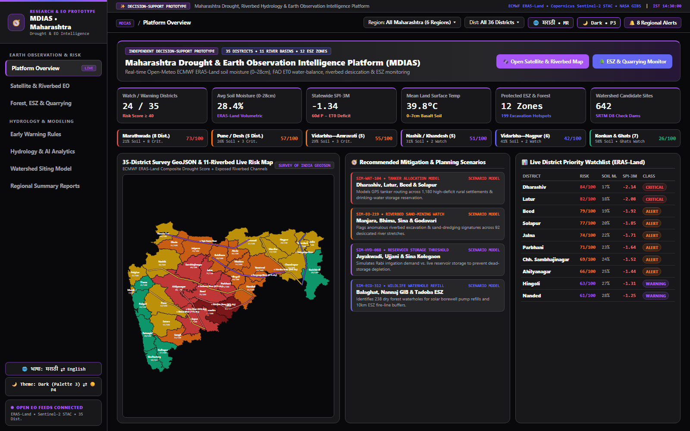
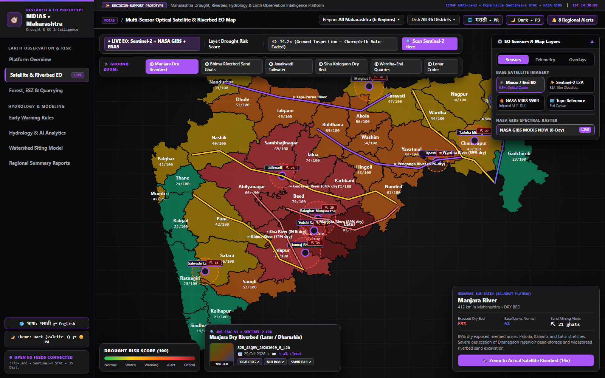
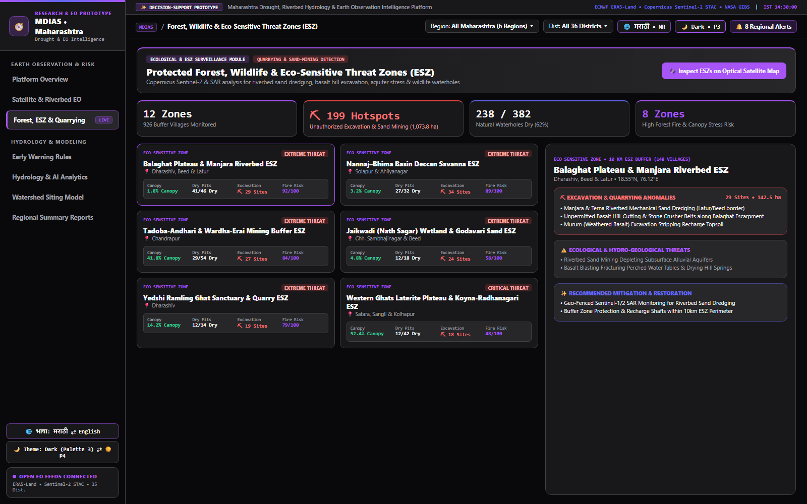
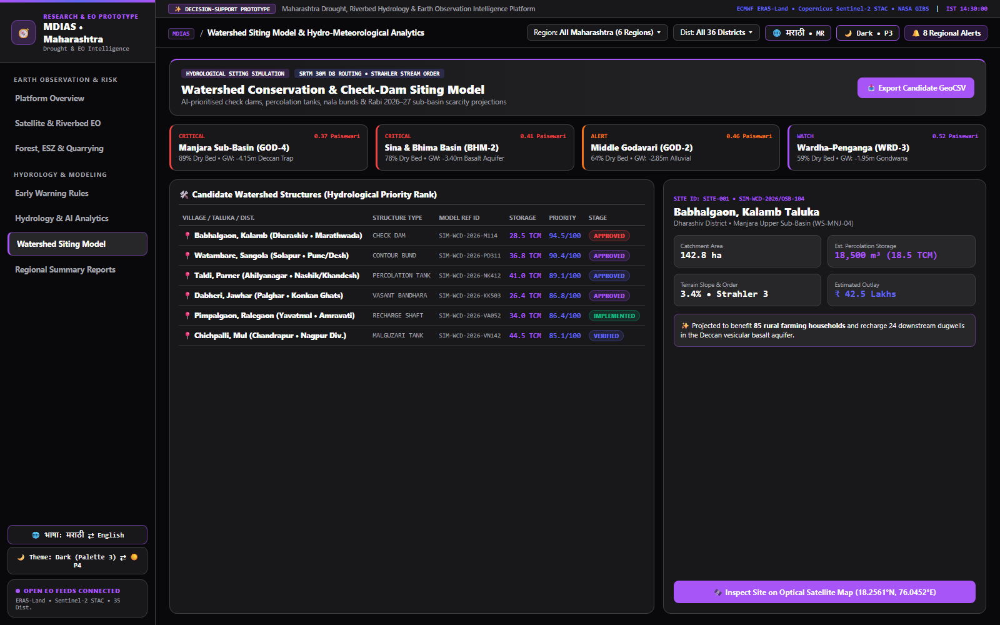
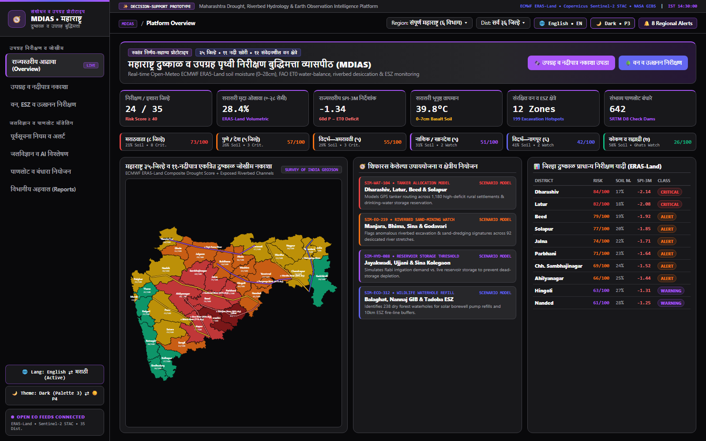
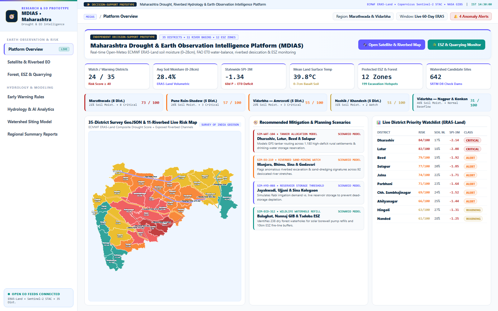
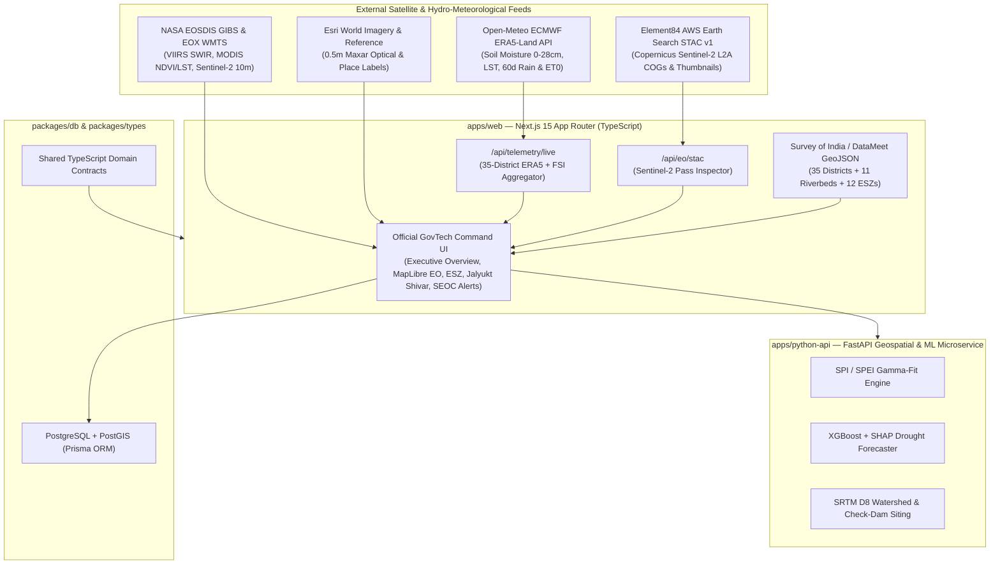

# 🇮🇳 MDIAS — Maharashtra Drought Intelligence, Riverbed Hydrology & Earth Observation Command System

[](https://nextjs.org/)
[](https://www.typescriptlang.org/)
[](https://maplibre.org/)
[](https://earth-search.aws.element84.com/v1)
[](https://open-meteo.com/)
[](https://fastapi.tiangolo.com/)

> **Independent Geospatial & Earth Observation Decision-Support Prototype**  
> Designed as a research and decision-support platform to present to water-resource engineers, agricultural planners, environmental researchers, and district administrators across all **35 districts of Maharashtra**. *(Note: This is an independent technical prototype and not an official government portal.)*

---

## 📸 Platform UI Showcase — Dual-Theme Architecture (Palette 3 Purple-Accent Dark ⇄ Palette 4 High-Trust Light)

The platform features a built-in **1-Click Light/Dark Theme Toggle** (`🌙 Dark • P3` ⇄ `☀️ Light • P4`) in the header and sidebar, persisted in `localStorage` (`mdias-theme`):
- **Dark Mode — Palette 3 (AI / Innovation Purple-Accent Dark)**: `#09090B` main canvas, `#18181B` cards, `#27272A` hover/tertiary surfaces, `#FAFAFA` primary typography (`19.1:1 AAA`), `#A855F7` primary purple interactive CTAs, `#6366F1` secondary indigo tags, and `#3F3F46` hairlines.
- **Light Mode — Palette 4 (High-Trust Light)**: `#F8FAFC` warm-cool slate canvas, `#FFFFFF` / `#EFF6FF` cards, `#0A2540` primary typography (`16.7:1 AAA`), `#635BFF` interactive CTAs, and `#C7A84B` accent indicators.

### 1. Platform Overview — Statewide Risk & Hydro-Meteorological Matrix (`/dashboard` • Palette 3 Dark)
Real-time ECMWF ERA5-Land volumetric soil moisture (`0–28 cm`), 60-day precipitation vs. FAO `ET0` water-balance deficit, 5-region scarcity breakdown, recommended mitigation scenarios (`SIM-...`), and the 35-District Survey GeoJSON & 11-Riverbed risk map.



### 2. Multi-Sensor Optical Satellite & Riverbed EO Map (`/dashboard/map` • Palette 3 Dark)
Interactive MapLibre GL Earth Observation workbench with 5 switchable satellite sensors (**Maxar/Esri 0.5m Optical**, **Copernicus Sentinel-2 L2A 10m**, **NASA VIIRS SWIR**, **Topo Reference**, **35-District GeoJSON**), live **NASA GIBS MODIS NDVI & Thermal LST** rasters, **11 Maharashtra Riverbeds** with `% Dry Bed` & sand-dredging alerts, a **1-Click Ground Zoom Bar** (`14x–15x` auto-fading choropleth), and live **Element84 AWS Earth Search STAC v1** Sentinel-2 pass thumbnails & GeoTIFF links.



### 3. Protected Forest, Wildlife & Eco-Sensitive Threat Zones (`/dashboard/wildlife` • Palette 3 Dark)
Monitoring across **12 Protected Areas & Eco-Sensitive Zones (ESZs)** tracking **199 unauthorized riverbed sand-dredging & basalt/laterite hill-excavation hotspots**, dry forest waterholes, solar borewell pumps, and ecological restoration recommendations.



### 4. Watershed Siting & Sub-Basin Hydrology Model (`/dashboard/interventions` • Palette 3 Dark)
SRTM 30m D8 flow-accumulation and Strahler stream-order siting model for check dams, percolation tanks, farm ponds, and recharge shafts, complete with *Paisewari* sub-basin metrics and simulation reference codes (`SIM-WCD-...`).



### 5. Bilingual Marathi (`मराठी • MR` ⇄ `English • EN`) & Light/Dark Theme Switchers
Instant 1-click toggle between **English** and **मराठी (Marathi)** (`🌐 मराठी • MR` / `🌐 English • EN`) as well as **Palette 3 Dark (`🌙 Dark • P3`)** and **Palette 4 High-Trust Light (`☀️ Light • P4`)**:

| Marathi (`मराठी`) Bilingual Interface (`🌐 मराठी • MR`) | Palette 4 High-Trust Light View (`☀️ Light • P4`) |
| :---: | :---: |
|  |  |

---

## 📌 Executive Overview

The **Maharashtra Drought Intelligence & Early Warning System (MDIAS)** is a full-stack geospatial and Earth Observation (EO) command platform engineered to monitor, forecast, and mitigate hydro-meteorological scarcity and ecological threats across all **35 districts of Maharashtra**—with specialized focus on **Marathwada**, **Vidarbha**, and the **Western Rain-Shadow belt**.

### Core Capabilities

1. **🛰️ Multi-Sensor Satellite & Earth Observation Map (`/dashboard/map`)**
   - **5 Switchable Earth Observation Base Sensors**:
     - **Maxar / Esri World Imagery (0.5m Optical)** — Zoom down to `15x–18x` to inspect exposed riverbeds, sand-mining pits, check dams, and quarry benches.
     - **Copernicus Sentinel-2 L2A Cloudless (10m EOX Mosaic)** — European Space Agency 10m optical mosaic.
     - **NASA EOSDIS GIBS VIIRS False-Color SWIR/NIR (Bands M11-I2-I1)** — Highlights surface water in deep navy/black, vegetation in bright green, and dry bare soil/quarries in crimson-orange.
     - **Esri Dark Gray Canvas + Reference Boundaries** — High-contrast vector topography.
     - **35-District Survey GeoJSON Vector Grid** — Instant statewide schematic view.
   - **Live NASA GIBS Spectral Raster Overlays**: Toggle real-time **MODIS Terra 8-Day NDVI** and **MODIS Daytime Land Surface Temperature (LST)** rasters.
   - **Smart Zoom-Adaptive Choropleth**: Statewide district color overlays automatically fade to transparent as you zoom past `11x` so officials can inspect unobstructed optical satellite imagery of the ground.

2. **🌊 Maharashtra Riverbeds & Sand-Mining Surveillance**
   - Interactive GeoJSON and SVG hydrography for **11 major drought-critical rivers**: **Godavari**, **Manjara**, **Sina**, **Bhima**, **Nira**, **Purna–Dudhana**, **Penganga**, **Wardha**, **Wainganga**, **Tapi–Purna**, and **Krishna–Koyna**.
   - Tracks `% Exposed Dry Riverbed`, `% Baseflow vs. Normal`, major dam storage (**Jayakwadi**, **Ujjani**, **Dhanegaon**, **Sina Kolegaon**, **Upper Wardha**, **Gosekhurd**), and **illegal mechanized riverbed sand-dredging alerts**.
   - Includes a **1-Click Ground Zoom Bar** to fly the satellite camera directly to exposed riverbeds, sand ghats, open-cast coal/basalt quarries, and Lonar Crater Lake.

3. **🌳 Forest, Wildlife & Eco-Sensitive Threat Zones (ESZ) (`/dashboard/wildlife`)**
   - Monitors **12 Protected Areas & Eco-Sensitive Threat Zones (ESZs)** across Maharashtra, including **Tadoba-Andhari**, **Melghat**, **Pench**, **Navegaon-Nagzira**, **Sahyadri**, **Tipeshwar**, **Great Indian Bustard Sanctuary (Nannaj)**, **Yedshi Ramling Ghat**, **Jaikwadi**, **Lonar Crater**, and the **Balaghat–Manjara / Western Ghats Laterite ESZs**.
   - Tracks **illegal excavation sites (sand dredging, basalt/laterite hill cutting, murum stripping)**, dry wildlife waterholes, solar pump status, and forest fire risk.

4. **📡 Live Telemetry & Copernicus Sentinel-2 STAC API**
   - **Live ERA5-Land Weather & Soil Telemetry (`/api/telemetry/live`)**: Queries Open-Meteo's ECMWF ERA5-Land model in real time for all 35 district centroids (`0–28 cm` volumetric soil moisture, surface/air temperature, 60-day cumulative precipitation vs. FAO `ET0` evapotranspiration, and SPI-3M).
   - **Live Copernicus Sentinel-2 L2A STAC Catalog (`/api/eo/stac`)**: Queries the **Element84 AWS Earth Search STAC v1 API** (`sentinel-2-l2a`) for any clicked coordinate in Maharashtra, returning recent satellite passes, cloud cover `%`, MGRS tile IDs, live 10m RGB thumbnails, and direct links to Cloud-Optimized GeoTIFFs (**RGB Visual**, **NIR Band B08**, **SWIR Band B11**).

---

## 🏗️ System Architecture



---

## 📂 Monorepo Structure

```text
mdias/
├── apps/
│   ├── web/                        # Next.js 15 App Router (Official Command Portal)
│   │   ├── public/data/            # Authentic 35-District Maharashtra GeoJSON
│   │   └── src/
│   │       ├── app/
│   │       │   ├── (dashboard)/    # Protected Executive Situation Room routes
│   │       │   │   └── dashboard/
│   │       │   │       ├── page.tsx            # State Situation Room Overview
│   │       │   │       ├── map/page.tsx        # Multi-Sensor EO & Riverbed Map
│   │       │   │       ├── wildlife/page.tsx   # Forest, Wildlife & ESZ Threats
│   │       │   │       ├── alerts/page.tsx     # SEOC Early Warning Directives
│   │       │   │       ├── analytics/page.tsx  # Basin Scarcity & SPI/NDVI Charts
│   │       │   │       ├── interventions/      # Jalyukt Shivar 2.0 Watershed Siting
│   │       │   │       ├── reports/page.tsx    # Collectorate & Cabinet Dossiers
│   │       │   │       └── settings/page.tsx   # API & Governance Controls
│   │       │   └── api/
│   │       │       ├── telemetry/live/route.ts # Live 35-District ERA5-Land Feed
│   │       │       └── eo/stac/route.ts        # Live Sentinel-2 STAC v1 Search
│   │       ├── components/         # MapLibre container, KPI cards, Header, Sidebar
│   │       └── lib/                # Riverbeds, ESZ zones, GeoJSON paths, color scales
│   └── python-api/                 # FastAPI Python 3.12 ML & Hydrological Engine
├── packages/
│   ├── db/                         # Prisma schema & PostgreSQL/PostGIS client
│   └── types/                      # Shared TypeScript interfaces (@mdias/types)
├── docs/                           # Architecture & Official Briefing Documentation
└── .agent/skills/                  # Custom Antigravity Skills (GovTech UI & GitHub Sync)
```

---

## 🚀 Quick Start

### 1. Prerequisites
- **Node.js** `>= 20.x` and **npm** `>= 10.x`
- **Python** `>= 3.11` (optional, for the FastAPI ML microservice)
- **Clerk Account** (for authentication keys in `apps/web/.env.local`)

### 2. Install Dependencies
```bash
npm install
```

### 3. Configure Environment Variables
Copy `.env.example` to `apps/web/.env.local` and add your Clerk keys:
```env
NEXT_PUBLIC_CLERK_PUBLISHABLE_KEY=pk_test_...
CLERK_SECRET_KEY=sk_test_...
NEXT_PUBLIC_CLERK_SIGN_IN_URL=/sign-in
NEXT_PUBLIC_CLERK_SIGN_UP_URL=/sign-up
NEXT_PUBLIC_CLERK_AFTER_SIGN_IN_URL=/dashboard
NEXT_PUBLIC_CLERK_AFTER_SIGN_UP_URL=/dashboard
```
*(Note: The satellite map, ERA5-Land telemetry, and Sentinel-2 STAC catalog require **zero API keys** out of the box.)*

### 4. Start the Development Server
```bash
cd apps/web
npx next dev -p 3000
```
Open **[http://localhost:3000](http://localhost:3000)** in your browser.

---

## 📚 Additional Documentation
- [**Architecture & Data Provenance (`docs/ARCHITECTURE.md`)**](./docs/ARCHITECTURE.md)
- [**Official Briefing & Presentation Guide (`docs/OFFICIAL_BRIEFING_GUIDE.md`)**](./docs/OFFICIAL_BRIEFING_GUIDE.md)
- [**GitHub Repo Sync Skill (`.agent/skills/github-repo-sync/SKILL.md`)**](./.agent/skills/github-repo-sync/SKILL.md)
- [**GovTech Official UI Skill (`.agent/skills/govtech-official-ui/SKILL.md`)**](./.agent/skills/govtech-official-ui/SKILL.md)

---

## 📜 License
Developed for drought resilience, watershed conservation, and ecological protection across Maharashtra.
