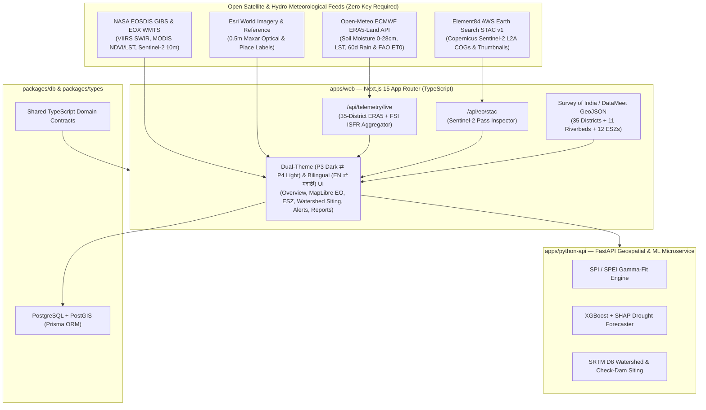

<div align="center">

# 🛰️ MDIAS — Maharashtra Drought, Riverbed Hydrology & Earth Observation Intelligence Platform

**Multi-Sensor Satellite Earth Observation, Hydro-Meteorological Telemetry & Watershed Decision-Support Prototype across All 6 Regions and 36 Districts of Maharashtra**

[](https://github.com/Lucifer2325/mdias-maharashtra-drought-eo/releases/tag/v1.0.0)
[](https://nextjs.org/)
[](https://www.typescriptlang.org/)
[](https://maplibre.org/)
[](https://earth-search.aws.element84.com/v1)
[](https://open-meteo.com/)
[](#%EF%B8%8F-bilingual-marathi-%E0%A4%AE%E0%A4%B0%E0%A4%BE%E0%A4%A0%E0%A5%80--dual-theme-architecture)

<br />

[](https://www.buymeacoffee.com/Lucifer2325)
[](https://github.com/sponsors/Lucifer2325)
[](https://ko-fi.com/Lucifer2325)

</div>

---

> **📌 Independent Geospatial & Earth Observation Decision-Support Prototype**  
> **MDIAS** is an open-architecture research and decision-support prototype built for water-resource engineers, agricultural planners, environmental researchers, and regional administrators across **all 6 Revenue Divisions and 36 Districts of Maharashtra**. *(Note: This is an independent technical research prototype and is not an official government portal.)*

---

## 📸 Platform Visual Showcase

### 1. Platform Overview — 6-Region Hydro-Meteorological Matrix & Live Risk Map (`/dashboard`)
Displays real-time **Open-Meteo ECMWF ERA5-Land** volumetric soil moisture (`0–28 cm`), 60-day cumulative precipitation vs. FAO Penman-Monteith evapotranspiration (`ET0`), interactive **6-Region Summary Cards**, **35-District Survey GeoJSON & 11-Riverbed Composite Risk Map**, and **6 Regional Mitigation Simulations (`SIM-...`)**.


---

### 2. Multi-Sensor Optical Satellite & Riverbed EO Workbench (`/dashboard/map`)
Interactive **MapLibre GL** Earth Observation workbench featuring **5 switchable satellite sensors** (**Maxar/Esri 0.5m Optical**, **Copernicus Sentinel-2 L2A 10m**, **NASA VIIRS SWIR**, **Topo Reference**, **35-District Survey GeoJSON**), live **NASA GIBS MODIS NDVI & Thermal LST** rasters, **11 Maharashtra Riverbeds** with `% Exposed Dry Bed`, a **1-Click Ground Zoom Bar** (`14x–15x` with auto-fading choropleth), and live **Element84 AWS Earth Search STAC v1** Sentinel-2 pass thumbnails & Cloud-Optimized GeoTIFF links.


---

### 3. Protected Forest, Wildlife & Eco-Sensitive Threat Zones (`/dashboard/wildlife`)
Monitors **12 Protected Areas & Eco-Sensitive Zones (ESZs)** across Maharashtra, tracking **199 riverbed sand-dredging & basalt/laterite hill-excavation hotspots**, dry wildlife waterholes, solar borewell pumps, and ecological buffer restoration priorities.


---

### 4. AI-Prioritised Watershed Siting & Sub-Basin Hydrology Model (`/dashboard/interventions`)
SRTM 30m DEM **D8 flow-accumulation** and **Strahler stream-order** siting model for **check dams**, **percolation tanks**, **farm ponds**, **nala bunds**, **recharge shafts**, **Malguzari tanks**, and **Konkan Vasant Bandharas** across all 6 Maharashtra regions.


---

### 5. 🗣️ Bilingual Marathi (`मराठी • MR` ⇄ `English • EN`) & Dual-Theme (`🌙 Dark • P3` ⇄ `☀️ Light • P4`) Switchers
One-click toggles in both the **Header** and **Sidebar** allow instant switching between **English** and **मराठी (Marathi)** as well as **Palette 3 (AI / Innovation Purple-Accent Dark)** and **Palette 4 (High-Trust Light)**:

| 🌐 Marathi (`मराठी • MR`) Bilingual View | ☀️ Palette 4 High-Trust Light Mode (`Light • P4`) |
| :---: | :---: |
|  |  |

---

## 🗺️ Complete Coverage: All 6 Regions & 36 Districts of Maharashtra

MDIAS covers every administrative revenue division, district, and major river basin in Maharashtra:

| # | Maharashtra Region / Division | Districts Covered (36 Total) | Primary River Basins & Hydro-Climatic Focus |
| :-: | :--- | :--- | :--- |
| **1** | **Marathwada** *(Chh. Sambhajinagar Div.)* | **Latur**, **Dharashiv (Osmanabad)**, **Beed**, **Chh. Sambhajinagar**, **Jalna**, **Parbhani**, **Hingoli**, **Nanded** *(8)* | **Godavari**, **Manjara**, **Sina**, **Purna–Dudhana**, **Penganga** — Acute root-zone soil moisture deficit, Jayakwadi/Dhanegaon storage, GPS tanker routing |
| **2** | **Vidarbha — Amravati** *(West Vidarbha Div.)* | **Yavatmal**, **Amravati**, **Akola**, **Buldhana**, **Washim** *(5)* | **Penganga**, **Purna (Tapi)**, **Upper Wardha** — Non-irrigated cotton/soybean dry-spell stress, Purna inland salinity belt, Melghat & Tipeshwar corridors |
| **3** | **Vidarbha — Nagpur** *(East Vidarbha Div.)* | **Nagpur**, **Wardha**, **Chandrapur**, **Gadchiroli**, **Bhandara**, **Gondia** *(6)* | **Wainganga**, **Wardha**, **Pranhita**, **Erai** — Historical *Malguzari* tank storage, Tadoba-Andhari / Pench / Navegaon-Nagzira tiger corridors & open-cast quarry monitoring |
| **4** | **Pune / Desh** *(Western Maharashtra Div.)* | **Solapur**, **Pune**, **Satara**, **Sangli**, **Kolhapur** *(5)* | **Bhima**, **Sina**, **Nira**, **Man**, **Krishna–Koyna** — Severe eastern rain-shadow scarcity (Sangola, Baramati, Indapur, Man-Khatav, Jath, Atpadi) & Ujjani tailwater |
| **5** | **Nashik / Khandesh** *(North Maharashtra Div.)* | **Ahilyanagar (Ahmednagar)**, **Nashik**, **Jalgaon**, **Dhule**, **Nandurbar** *(5)* | **Upper Godavari**, **Pravara–Mula**, **Tapi**, **Girna**, **Panzara** — Deep alluvial aquifer drawdown in banana/cotton belts & rain-shadow scarcity in Parner/Sangamner/Malegaon |
| **6** | **Konkan & Western Ghats** *(Coastal Div.)* | **Palghar**, **Thane**, **Raigad**, **Ratnagiri**, **Sindhudurg**, **Mumbai Suburban**, **Mumbai City** *(7)* | **Vaitarna**, **Ulhas**, **Savitri**, **Vashishti**, **Tillari** — Post-monsoon runoff loss & March–May drinking-water stress on steep lateritic tribal plateaus (Jawhar, Mokhada, Poladpur) |

---

## ✨ Key Capabilities & Modules

1. **🛰️ Zero-API-Key Multi-Sensor Earth Observation Map (`/dashboard/map`)**
   - **Maxar / Esri World Imagery (0.5m Optical)** — Zoom down to `15x–18x` to inspect exposed riverbeds, check dams, sand ghats, and quarry benches with zero API key required.
   - **Copernicus Sentinel-2 L2A Cloudless (10m EOX WMTS)** — European Space Agency 10m optical mosaic.
   - **NASA EOSDIS GIBS VIIRS False-Color SWIR/NIR (Bands M11-I2-I1)** — Highlights surface water in deep navy/black, vegetation in bright green, and bare soil/quarries in crimson-orange.
   - **Live NASA GIBS Spectral Raster Overlays** — Real-time **MODIS Terra 8-Day NDVI** and **MODIS Daytime Land Surface Temperature (LST)**.
   - **Live Element84 AWS Earth Search STAC v1 Inspector (`/api/eo/stac`)** — Click anywhere in Maharashtra to query live **Copernicus Sentinel-2 L2A** satellite passes, cloud cover `%`, MGRS tile IDs, 10m RGB thumbnails, and direct links to Cloud-Optimized GeoTIFFs (**RGB Visual**, **NIR B08**, **SWIR B11**).

2. **🌊 11 Maharashtra Riverbeds & Sand-Dredging Surveillance**
   - Tracks `% Exposed Dry Riverbed`, `% Baseflow vs. Normal`, dam live storage (**Jayakwadi**, **Ujjani**, **Dhanegaon**, **Sina Kolegaon**, **Upper Wardha**, **Gosekhurd**, **Hatnur**, **Girna**), and anomalous riverbed sand-excavation hotspots across **Godavari, Manjara, Sina, Bhima, Nira, Purna–Dudhana, Penganga, Wardha, Wainganga, Tapi–Purna, and Krishna–Koyna**.

3. **🔔 Interactive Notification Center & Early-Warning Engine (`/dashboard/alerts` & `/dashboard/settings`)**
   - Stateful Notification Center in the header with `All`, `Unread`, and `Critical` filters, 1-click deep-linking, mark-all-read, dismiss, and reset actions.
   - Configurable threshold rules (`SPI_3M`, `NDVI_ANOMALY`, `RESERVOIR_FILL`, `GROUNDWATER_DEPTH`, `RISK_SCORE`) across all 6 regions and 36 districts with Email, SMS, and JSON Webhook channels.

4. **🎨 Dual-Theme Architecture & Bilingual (`EN ⇄ मराठी`) Engine**
   - **Palette 3 (AI / Innovation Purple-Accent Dark)**: `#09090B` main zinc-obsidian canvas, `#18181B` cards, `#27272A` tertiary hover states, `#FAFAFA` primary text (`19.1:1 AAA`), `#A855F7` purple CTAs, and `#6366F1` indigo accents.
   - **Palette 4 (High-Trust Light)**: `#F8FAFC` main canvas, `#FFFFFF` / `#EFF6FF` cards, `#0A2540` primary text (`16.7:1 AAA`), and `#635BFF` interactive accents.
   - **Instant Reversible Marathi (`मराठी`) Translation**: 350+ exact and phrase-level translations for all 36 Maharashtra districts, 6 regions, 11 rivers, drought classifications, and hydrological terms.

---

## 🏗️ System Architecture



---

## 📂 Monorepo Structure

```text
mdias/
├── .github/
│   └── FUNDING.yml                             # GitHub Sponsors, Buy Me a Coffee & Ko-fi config
├── .agent/
│   └── skills/
│       ├── govtech-official-ui/SKILL.md        # Dual-Theme (Palette 3 Dark ⇄ Palette 4 Light) UI Skill
│       └── github-repo-sync/                   # Automated GitHub Sync & Release Skill
├── apps/
│   ├── web/                                    # Next.js 15 App Router (TypeScript + Tailwind + MapLibre)
│   │   ├── public/data/                        # Survey of India / DataMeet 35-District GeoJSON
│   │   └── src/
│   │       ├── app/
│   │       │   ├── (dashboard)/dashboard/      # Overview, Map, Wildlife, Alerts, Analytics, Interventions, Reports, Settings
│   │       │   └── api/                        # /api/telemetry/live, /api/eo/stac, /api/alerts, /api/interventions
│   │       ├── components/                     # Header (Theme + Marathi + Notification Center), Sidebar, MapLibre Container
│   │       └── lib/                            # i18n.ts (EN ⇄ मराठी), maharashtra-rivers.ts, wildlife-zones.ts
│   └── python-api/                             # FastAPI Python 3.12 Geospatial & ML Microservice
│       └── app/
│           ├── routers/                        # /indices (SPI/SPEI), /forecast (XGBoost), /interventions (SRTM D8)
│           └── services/                       # Copernicus STAC, CHIRPS, MODIS & DEM Processing
├── docs/
│   └── screenshots/                            # High-resolution UI proof screenshots (Dark, Light & Marathi)
└── packages/
    ├── db/                                     # Prisma PostgreSQL + PostGIS schema & seed
    └── types/                                  # Shared TypeScript interfaces (@mdias/types)
```

---

## 🚀 Quickstart & Local Development

### Prerequisites
- **Node.js** `>= 20.x` & **npm** `>= 10.x`
- **Python** `>= 3.11` *(optional, for the FastAPI ML microservice)*

### 1. Clone & Install Dependencies

```bash
git clone https://github.com/Lucifer2325/mdias-maharashtra-drought-eo.git
cd mdias-maharashtra-drought-eo
npm install
```

### 2. Configure Environment Variables

```bash
cp .env.example apps/web/.env.local
```

> **Zero API Key Required for Satellite Map & Live Telemetry**: MapLibre GL, Esri 0.5m World Imagery, Copernicus Sentinel-2 10m Cloudless, NASA GIBS MODIS/VIIRS rasters, Element84 AWS Earth Search STAC v1, and Open-Meteo ECMWF ERA5-Land all run out-of-the-box without paid API keys.

### 3. Start the Web Application

```bash
cd apps/web
npx next dev -p 3000
```

Open **[http://localhost:3000/dashboard](http://localhost:3000/dashboard)** in your browser.

---

## ☕ Support the Project & Buy Me a Coffee

Building and maintaining open-access Earth Observation, riverbed hydrology, and drought-resilience tools for Maharashtra takes continuous research, satellite data pipeline engineering, and compute resources.

If you find **MDIAS** useful for your research, coursework, watershed planning, or civic-tech work, consider supporting the project:

<div align="center">

[-FFDD00?style=for-the-badge&logo=buy-me-a-coffee&logoColor=black)](https://www.buymeacoffee.com/Lucifer2325)
[](https://github.com/sponsors/Lucifer2325)
[](https://ko-fi.com/Lucifer2325)

</div>

- **☕ Buy Me a Coffee**: [https://www.buymeacoffee.com/Lucifer2325](https://www.buymeacoffee.com/Lucifer2325)
- **💖 GitHub Sponsors**: [https://github.com/sponsors/Lucifer2325](https://github.com/sponsors/Lucifer2325)
- **⭐ Star the Repository**: Giving a star on [GitHub](https://github.com/Lucifer2325/mdias-maharashtra-drought-eo) helps researchers and water-resource engineers discover this project!

---

## 📜 License & Attribution

- **Satellite & Meteorological Data Attribution**:
  - **ECMWF ERA5-Land** via [Open-Meteo API](https://open-meteo.com/)
  - **Copernicus Sentinel-2 L2A** via [Element84 AWS Earth Search STAC v1](https://earth-search.aws.element84.com/v1) & [EOX Maps](https://maps.eox.at/)
  - **MODIS NDVI / LST & VIIRS SWIR** via [NASA EOSDIS GIBS](https://earthdata.nasa.gov/eosdis/science-system-description/eosdis-components/gibs)
  - **0.5m Optical Imagery** via Esri World Imagery
- **License**: Released under the **MIT License** for academic, environmental, and decision-support research.
