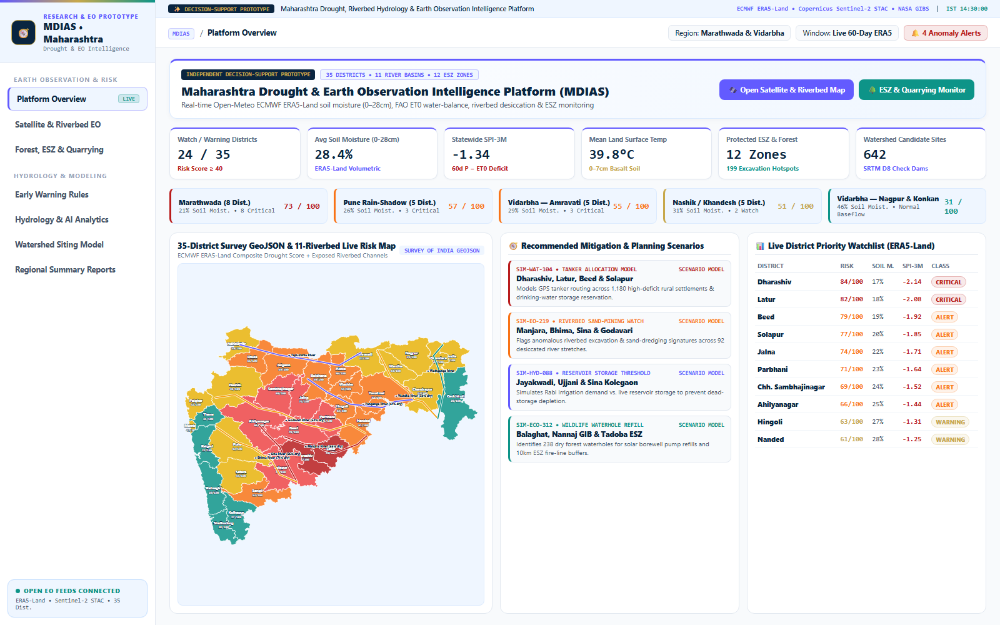
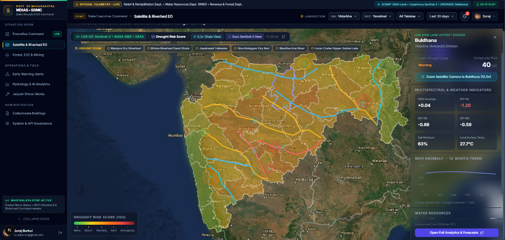
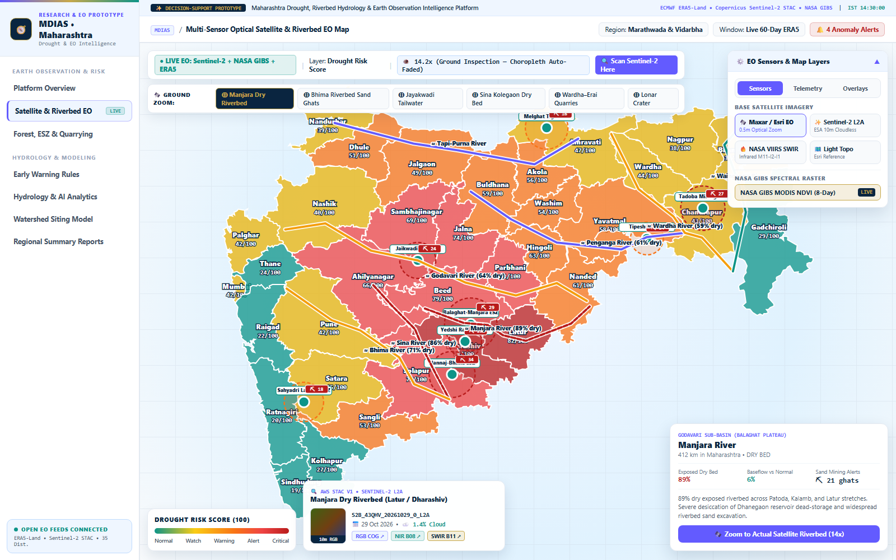
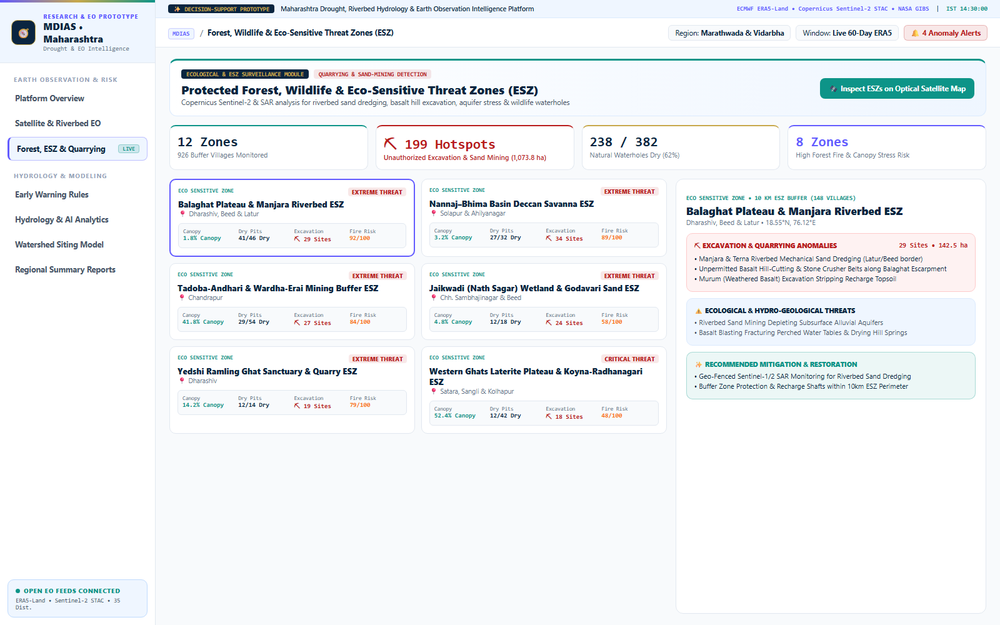
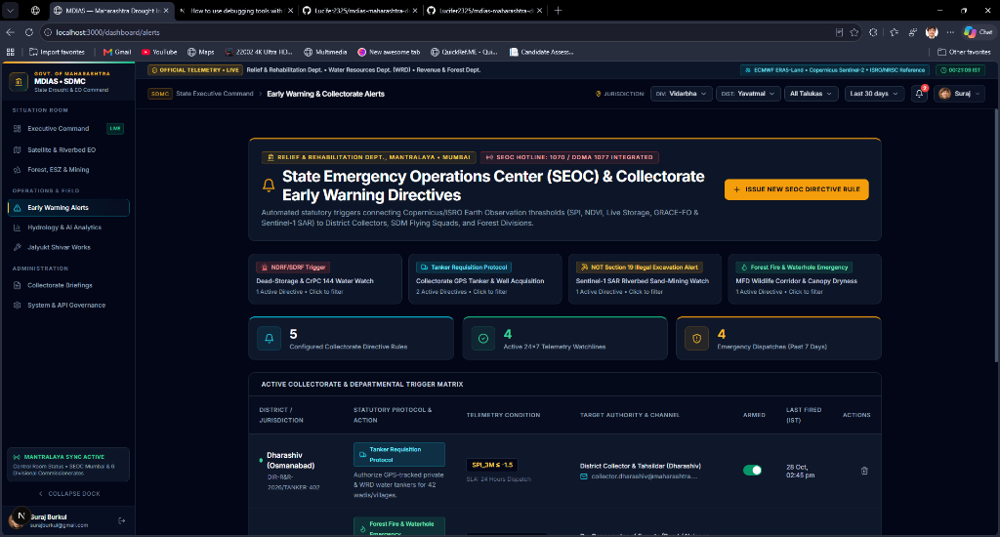
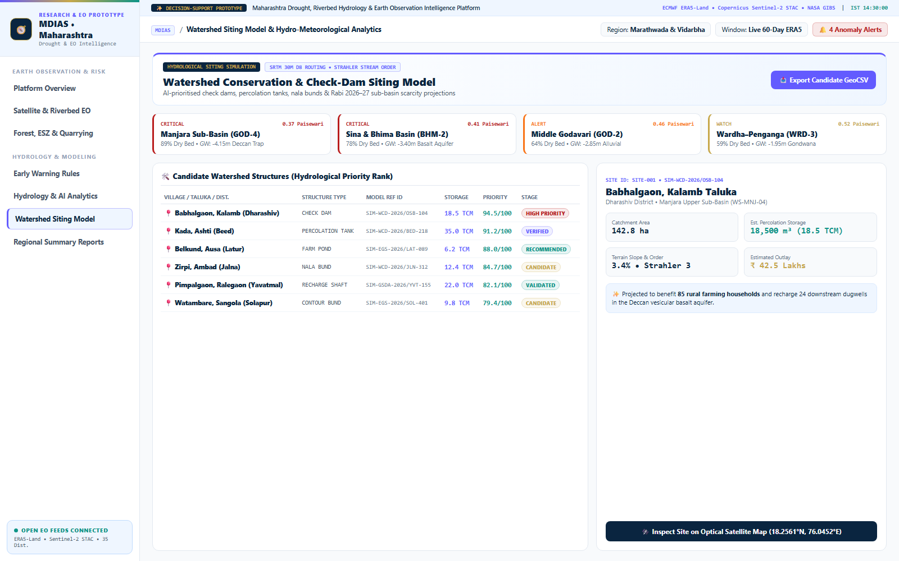

# Presentation & Demo Walkthrough Guide (Decision-Support Prototype)

This guide outlines a structured **5-minute live demonstration** of the **Maharashtra Drought & Earth Observation Intelligence Platform (MDIAS)** prototype when presenting the system to officials, water-resource engineers, and researchers.

---

## Step 1: Platform Overview (`/dashboard`)

1. Point out the **Decision-Support Prototype Provenance Bar** at the top (`Open-Meteo ECMWF ERA5-Land • Copernicus Sentinel-2 STAC • NASA EOSDIS GIBS`) and the live ticking **IST Clock**.
2. Highlight the **Regional Situational Summary Matrix**, which aggregates live ECMWF ERA5-Land telemetry across **Marathwada**, **Vidarbha**, **Pune & Western Rain-Shadow**, **Nashik**, and **Konkan**.
3. Review the **Recommended Mitigation Scenarios Matrix** (`SIM-WAT-104` Tanker Allocation Modeling, `SIM-EO-219` Riverbed Sand-Dredging Detection, `SIM-HYD-088` Reservoir Dead-Storage Thresholds, and `SIM-ECO-312` Wildlife Waterhole Solar Pump Planning).

---

## Step 2: Multi-Sensor Satellite & Riverbed Inspection (`/dashboard/map`)

1. **Statewide Choropleth & Riverbed View (`Zoom 6.2x`)**:
   - Show the 35-district risk choropleth overlaid with **11 major Maharashtra riverbeds** (dashed red for dry beds like **Manjara** and **Sina**; amber for critically depleted reaches like **Bhima** and **Godavari**) and **red dashed ESZ threat rings**.
2. **1-Click Ground Zoom to Actual Riverbed Conditions (`Zoom 14x–15x`)**:
   - In the top **Ground Zoom** bar, click **Manjara Dry Riverbed**, **Bhima Riverbed Sand Ghats**, or **Wardha–Erai River**.
   - As the camera flies in past `11x`, notice how the district color overlay **automatically fades to transparent**, revealing high-resolution optical satellite imagery of the exposed dry riverbeds, receding reservoir shorelines, sandbars, and open-cast quarries.
3. **Live Copernicus Sentinel-2 STAC Pass Feed (Bottom-Left Dock)**:
   - Show the live **AWS STAC v1 • Sentinel-2 L2A** card displaying the actual recent Copernicus satellite pass thumbnail, UTC date, cloud cover `%`, and one-click links to full-resolution **RGB**, **NIR B08**, and **SWIR B11** GeoTIFFs.
4. **Switch Earth Observation Sensors (Top-Right `Sensors` Tab)**:
   - Toggle between **Maxar / Esri EO (0.5m)**, **Sentinel-2 L2A (10m)**, **NASA VIIRS SWIR (Infrared)**, and enable the **NASA GIBS MODIS NDVI / Thermal LST** live spectral overlays.

---

## Step 3: Eco-Sensitive Threat Zones & Illegal Excavation (`/dashboard/wildlife`)

1. Open **Forest, ESZ & Mining** from the sidebar.
2. Select **Balaghat Plateau & Manjara Riverbed ESZ**, **Nannaj–Bhima Basin Deccan Savanna ESZ**, or **Tadoba-Andhari & Wardha-Erai Mining Buffer ESZ**.
3. Review the **Illegal Excavation & Unauthorized Quarrying Surveillance** red alert box detailing mechanized suction sand dredging, basalt hill-cutting, and NGT enforcement recommendations.

---

## Step 4: Jalyukt Shivar 2.0, SEOC Alerts & Collectorate Briefings

1. **Jalyukt Shivar Works (`/dashboard/interventions`)**: Inspect D8 hydrologically ranked check-dam, percolation-tank, and nala-bund candidate sites with Government Resolution numbers (`GR-WCD-2026/...`) and estimated percolation storage.
2. **Early Warning Alerts (`/dashboard/alerts`)**: Filter active directives by `Tanker Requisition Protocol` or `NGT Section 19 Illegal Excavation Alert`.
3. **Collectorate Briefings (`/dashboard/reports`)**: Click **Print / PDF** to generate an official Cabinet Briefing Sheet with *Paisewari (Annewari)* scarcity figures.
